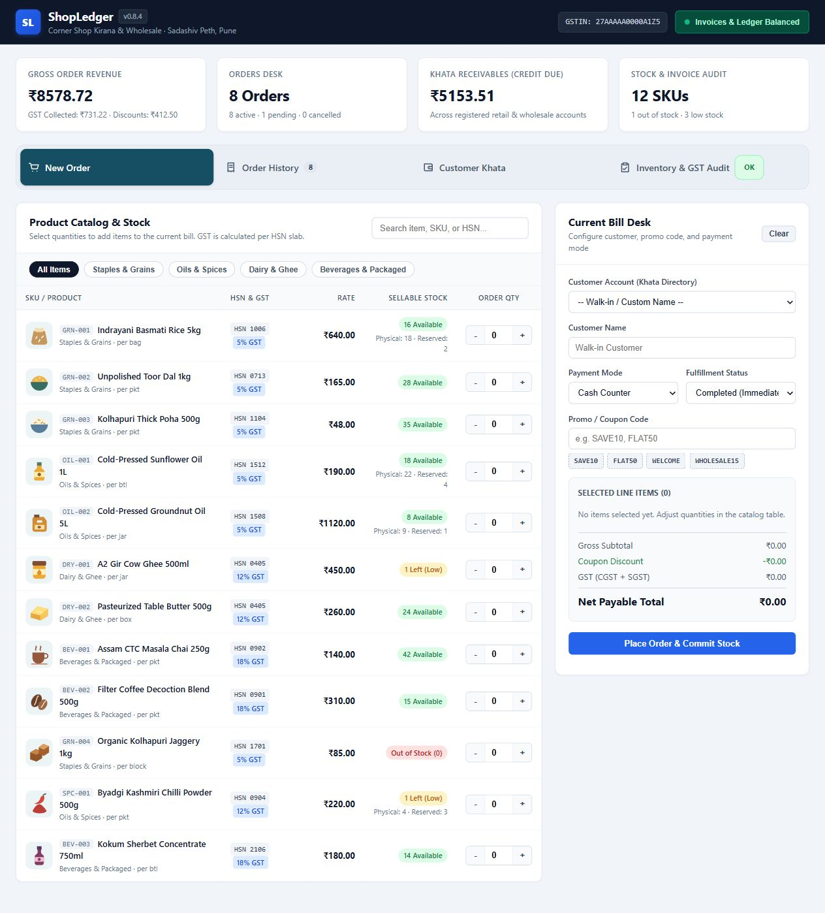

# ShopLedger

ShopLedger is a small billing, inventory, and customer-credit (Khata) app for a retail and wholesale shop. It runs on Node.js and Express with a plain HTML, CSS, and JavaScript frontend.

## Updated interface

The point-of-sale screen has responsive navigation, a clear active tab, and an illustration for each product SKU.



## Fixed issues

- [#1 · Invoice totals and GST](https://github.com/SampurnR/shopledger-legacy-workshop/issues/1) — Invoices use checkout pricing for discounts, GST, and rounding.
- [#2 · Stock and cancellations](https://github.com/SampurnR/shopledger-legacy-workshop/issues/2) — Staff can sell the exact available quantity. Cancelling an order restores physical stock and preserves wholesale reservations.
- [#3 · Order History and Khata](https://github.com/SampurnR/shopledger-legacy-workshop/issues/3) — Orders sort newest first, date filters include both endpoints, and settlements add amounts numerically.

## Run locally

```sh
npm install
npm start
```

Open [http://localhost:3000](http://localhost:3000). Run the regression suite with `node --test`.
